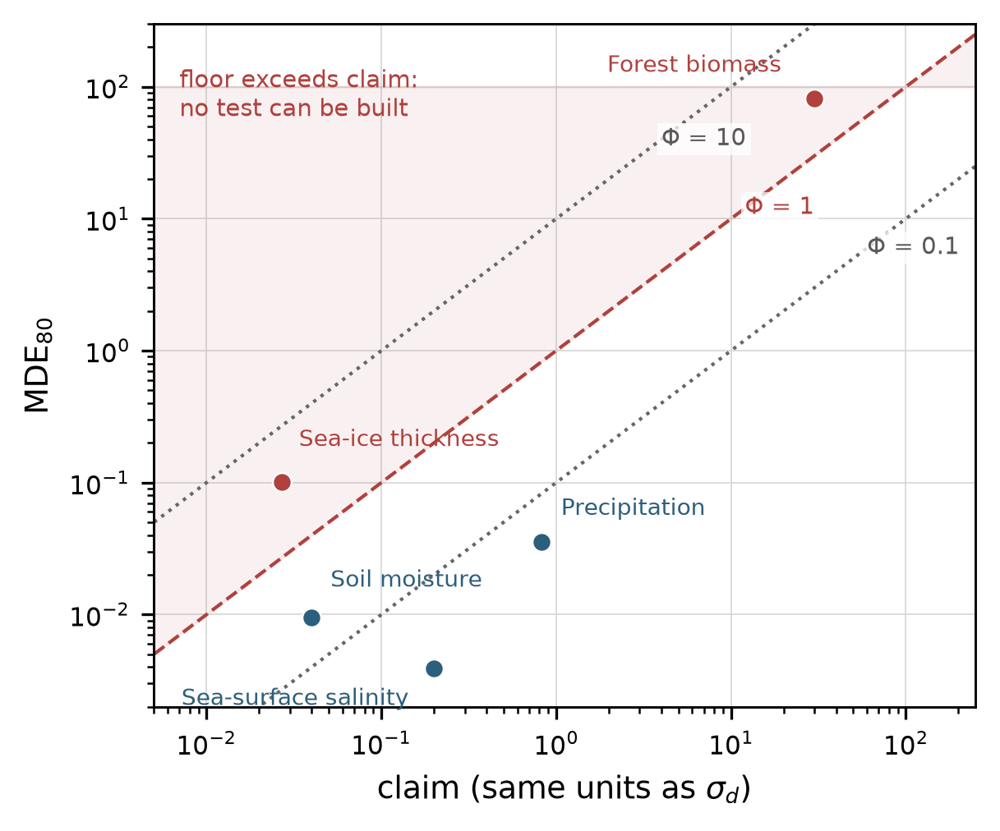

# Verification floor Φ

  
  

  

A claim about model error can only be tested if the archive used to test it carries
enough independent information. This repository implements the dimensionless floor
that says how much,

    Φ = 2.802 · σ_d / (claim · √n_eff)

together with the Arctic sea-ice archive recomputation that supplies its hardest
case, and every sensitivity grid reported in the paper. `Φ > 1` means the claim
cannot be verified by this archive; `Φ < 1` means it can be — not that it is right.

*Floor versus claim for the five domains. Diagonals are Φ = 0.1, 1, 10; the shaded
region is the unverifiable side. Salinity and precipitation sit far below the
watershed, soil moisture just below it, sea ice and biomass above it.*

## What it settles

| quantity | value |
|---|---|
| Φ, sea-surface salinity | 0.019 |
| Φ, precipitation | 0.043 |
| Φ, soil moisture | 0.24 |
| Φ, sea-ice thickness | 1.3–3.7 (two kernels) |
| Φ, forest biomass | 2.71 |
| sea-ice floor, empirical / exponential kernel | 3.447 cm / 10.10 cm |
| n_eff, eleven-winter archive | 3,534 (43 pooled months: 13,816) |

## Contents

    code/        phi_core · archive_recompute · run_all · make_figures · tests
    data/        every table the paper quotes, as CSV (see data/README.md)
    figures/     the seven figures
    manuscript.tex, supplement.tex, refs.bib    submission-side sources
    REPRO_CHECK.txt   environment, run order, expected values

## Quick start

    pip install numpy scipy pandas matplotlib pytest
    python code/run_all.py          # arithmetic, number check, figures, both PDFs
    python -m pytest code           # ten regression tests

`run_all.py` exits non-zero if any headline number moves by more than 0.1 % from the
value printed in the manuscript, so it doubles as a submission gate. The sea-ice
example reads two product fields that are not redistributed; without them
`archive_recompute.py` falls back to the two CSVs those fields produced and
recomputes the same summary.

## The paper

*A dimensionless verification floor for model assessment* — submitted to
**Computers & Geosciences**. Sections 3–5 are reproduced here; `REPRO_CHECK.txt`
maps each number to the file that produces it.

## Licence and citation

Code MIT (`LICENSE`), derived tables CC BY 4.0 (`DATA_LICENSE`). Cite the article
and this repository — see `CITATION.cff`.

---
[中文说明](README.zh-CN.md)
