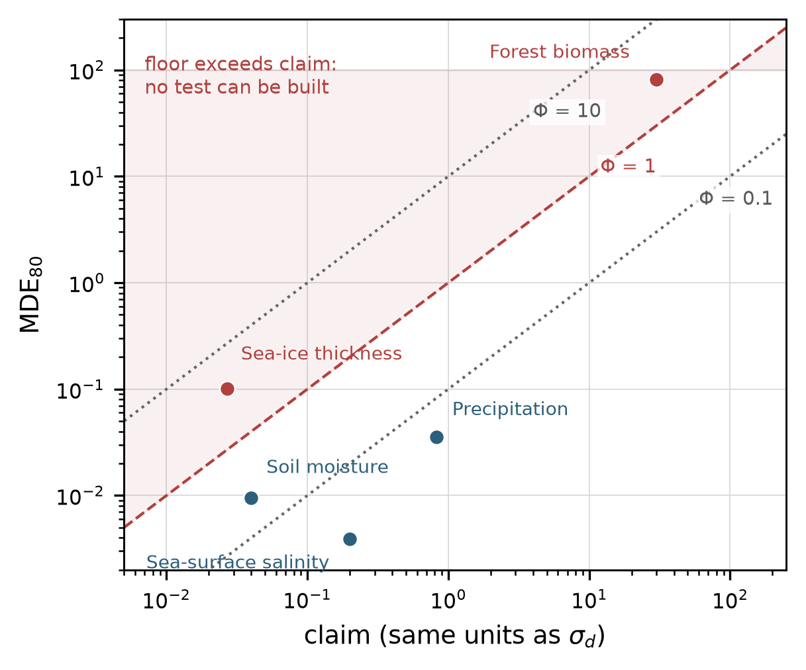

# 验证下限 Φ

  

一个关于模型误差的主张，只有在用来检验它的档案包含足够独立信息时才可检验。本仓库实现了
刻画"需要多少信息"的无量纲下限，

    Φ = 2.802 · σ_d /（claim · √n_eff）

以及供它做最硬例子的北极海冰厚度档案重算，和论文中全部敏感性网格。`Φ > 1` 表示该主张无法
被这份档案验证；`Φ < 1` 表示可以验证——但不表示它是对的。

*五个领域的下限与主张量级。对角线为 Φ = 0.1、1、10，阴影区为不可验证一侧。盐度与降水远在
分界之下，土壤湿度略低于分界，海冰与生物量在分界之上。*

## 它确定了什么

| 量 | 数值 |
|---|---|
| Φ，海表盐度 | 0.019 |
| Φ，降水 | 0.043 |
| Φ，土壤湿度 | 0.24 |
| Φ，海冰厚度 | 1.3–3.7（两种核） |
| Φ，森林生物量 | 2.71 |
| 海冰下限，经验核 / 指数核 | 3.447 cm / 10.10 cm |
| n_eff，十一个冬季档案 | 3,534（43 个月合并：13,816） |

## 目录

    code/        phi_core · archive_recompute · run_all · make_figures · tests
    data/        论文引用的全部表格（CSV，说明见 data/README.md）
    figures/     七张图
    manuscript.tex, supplement.tex, refs.bib    投稿侧源文件
    REPRO_CHECK.txt   环境、运行顺序、预期数值

## 快速开始

    pip install numpy scipy pandas matplotlib pytest
    python code/run_all.py          # 算术、数字校验、出图、两份 PDF
    python -m pytest code           # 十个回归测试

`run_all.py` 在任一头部数字相对手稿偏移超过 0.1 % 时以非零码退出，因此它同时是投稿闸门。
海冰示例读取两个不随包分发的产品场；没有它们时 `archive_recompute.py` 退回到那两个场生成的
两张 CSV，重算同一份汇总。

## 对应论文

*A dimensionless verification floor for model assessment*，拟投
**Computers & Geosciences**。本仓复现第 3–5 节；`REPRO_CHECK.txt` 给出每个数字对应的文件。

## 许可与引用

代码 MIT（`LICENSE`），派生表 CC BY 4.0（`DATA_LICENSE`）。引用请同时引论文与本仓，
见 `CITATION.cff`。

---
[English](README.md)
